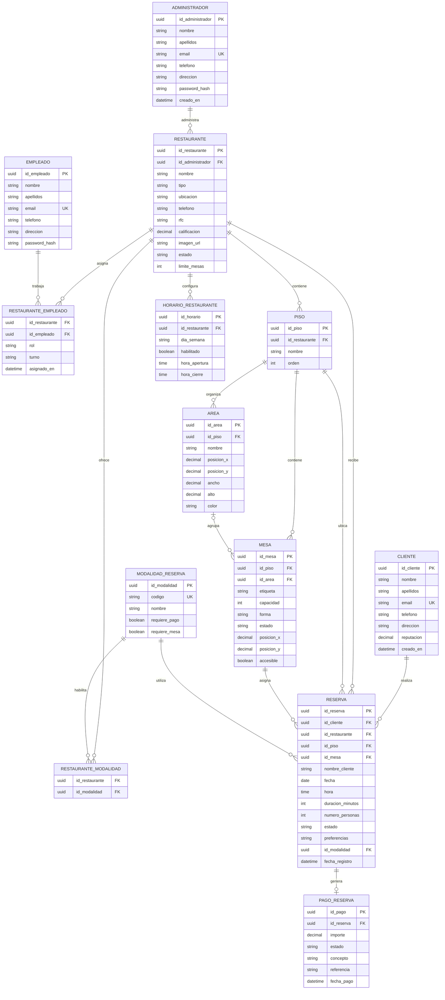

# Diagrama de base de datos — SDReservas

Este modelo adapta el diagrama original a las entidades y datos que utiliza actualmente la aplicación. Está pensado para una futura persistencia relacional; no representa la implementación actual, que todavía usa Redux y `localStorage`.

## Decisiones de adaptación

- `PISO`, `MESA` y `AREA` separan el plano interactivo que actualmente está anidado dentro del restaurante.
- `RESTAURANTE_EMPLEADO` resuelve correctamente la relación muchos-a-muchos del diagrama original.
- `HORARIO_RESTAURANTE` corresponde al horario semanal configurable desde el panel administrativo.
- `MODALIDAD_RESERVA` y `PAGO_RESERVA` cubren las modalidades y anticipos simulados por el formulario actual.
- `estado` de `RESERVA` admite `upcoming`, `completed` y `cancelled`; `estado` de `MESA` admite `available`, `reserved`, `occupied` y `out-of-service`.
- Las contraseñas se representan como `password_hash`; nunca deben almacenarse en texto plano.
- En una implementación real, `RESERVA` debe tener una restricción para impedir solapamientos de reservas activas sobre la misma mesa.
